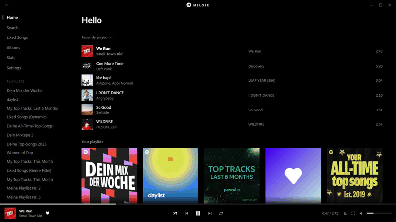
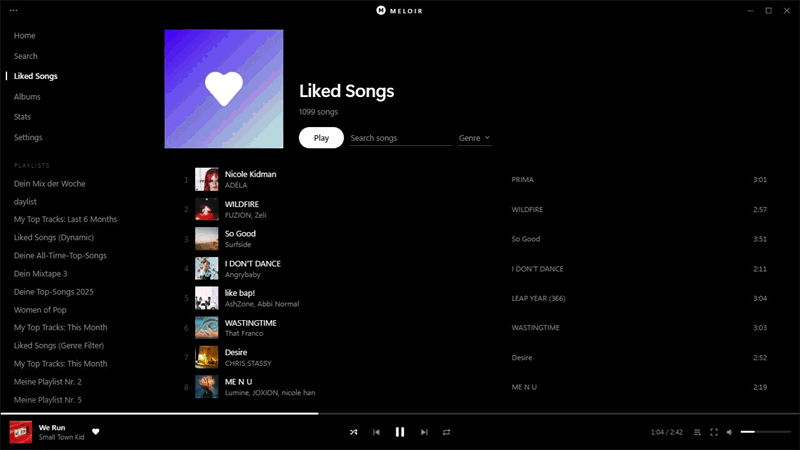
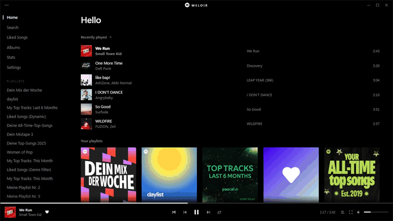

  <picture>
    <source media="(prefers-color-scheme: dark)" srcset="assets/logo-animated.svg">
    
  </picture>

<h1 align="center">Meloir</h1>

  A pure black interface for the Spotify desktop app on Windows. 
  The only colour on screen comes from the covers.

  <a href="https://github.com/pascalnot/Meloir/releases/latest"><b>Download</b></a>
  &nbsp;·&nbsp;
  <a href="#features">Features</a>
  &nbsp;·&nbsp;
  <a href="#install">Install</a>
  &nbsp;·&nbsp;
  <a href="#good-to-know">Good to know</a>

  

Spotify does the playback and Meloir draws its own screens over it. Spotify's files are not changed,
Meloir does not use Spicetify, and it works on a free account.

## Features

### Focus mode

The cover on a black screen, with a soft glow taken from its colours. Lyrics follow the song word by
word where timing is available. The cover leans toward the mouse, and the line at the bottom pulses
on beats and flashes on drops.

### Queue

Slide the queue in with <kbd>Q</kbd> and drag songs into a new order. When the next song starts, the
list moves up with it.

### Find and organise

Search any playlist or Liked Songs as you type, filter by genre, and right-click a song to queue it, like it, add it
to a playlist or start a radio from it.

### Stats

See how long you have listened, with your top songs and artists. It all stays on your PC. The recording below uses sample numbers.

### Settings and themes

Everything sits in one sorted page, with Dark and White themes.

### And more

- **Mix:** an artist's hits and deep cuts in turn with similar artists, built fresh on every press
- **Song radio:** Spotify's radio for any song, starting with that song
- **Albums:** your saved albums, plus the ones you've liked the most songs from
- **Stats:** time listened and your top songs and artists, kept on your PC
- **Recently played and recent searches**
- **Smooth transitions:** each song fades into the next, on a free account too
- **Idle screen:** the cover fills the window when you step away
- **Cover backdrop:** an optional soft, blurred copy of the cover behind everything
- **Song menu:** add to a playlist, go to the album or artist, copy the song's link, or remove it from Liked Songs or your own playlists, also from the cover in the player bar
- **Discord status:** optionally shows the song you're playing on your Discord profile
- **Equalizer, cursor glow and pause fades**
- **Ad handling:** see [Good to know](#good-to-know)
- **Updates:** Meloir tells you when a new version is out and installs it in one click

## Install

You need the [Spotify desktop app](https://www.spotify.com/download/windows/) from spotify.com. The
Microsoft Store version is not supported.

1. Download `MeloirSetup.exe` from [the latest release](https://github.com/pascalnot/Meloir/releases/latest).
2. Run it. If SmartScreen warns you, choose **More info**, then **Run anyway**, because the installer
   is not code-signed. No admin rights are needed.
3. Open Meloir from the Start menu.

Meloir restarts Spotify when it opens, so anything playing stops for a moment. Opening Spotify by itself
gives you the normal app. While Meloir runs, Spotify's window sits on Meloir's taskbar button, so you can
unpin Spotify.

To remove Meloir, run `MeloirSetup.exe` again and choose **Uninstall**, or use Windows Settings. Spotify is
not touched.

## Keys

| Key | Does |
|---|---|
| <kbd>Space</kbd> | Play or pause, with a short fade |
| <kbd>F</kbd> | Focus mode |
| <kbd>L</kbd> | Show or hide lyrics in focus mode |
| <kbd>Q</kbd> | Show or hide the queue |
| <kbd>Ctrl</kbd>+<kbd>K</kbd> | Search |
| <kbd>Ctrl</kbd>+<kbd>F</kbd> | Filter the songs in a playlist or Liked Songs |
| <kbd>?</kbd> | Show all shortcuts |
| <kbd>Esc</kbd> | Close what's open |
| <kbd>Ctrl</kbd>+<kbd>Shift</kbd>+<kbd>U</kbd> | Show or hide the real Spotify interface underneath |

## Good to know

**Ads and your account.** Meloir switches off the app's ad managers, empties and disables its ad slots,
and mutes anything that still plays as an ad. It never reports the account as Premium. Blocking ads
goes against Spotify's Terms of Use, and Spotify may suspend accounts that do it. Use it at your own
risk.

**Sound.** The equalizer, crossfade and AutoMix are Spotify's own, so they change Spotify's settings
too. Crossfade and AutoMix did not overlap songs on a free account in testing. Smooth transitions are
Meloir's own: each song fades out, its last 1.5 seconds are skipped, and the next song fades in, so the
two never play at once. They can be turned off in Settings.

**Lyrics.** Word timing comes from [LyricsPlus](https://lyricsplus.binimum.org),
[lrc.red](https://lrc.red) and [LRCLIB](https://lrclib.net), which receive the song's title, artist and length. It isn't available for
every song, and those songs use Spotify's line timing instead.

**Glow.** The beat and drop glow follow Spotify's analysis of each song, not the sound itself, so a
song without an analysis does not glow.

**Mix and Song radio** turn shuffle off to keep their order, and shuffle stays off afterwards.

**Genres.** Spotify doesn't give the desktop app genres, so the genre menu asks Wikidata, which receives
Spotify artist ids and artist names and answers for hundreds of artists within seconds. Artists it doesn't
know go to Apple's iTunes catalogue, which receives their names, at about 19 a minute. It only starts when
you first open the menu, and each artist is looked up once, those with the most songs first. Genres belong
to artists rather than songs, and they are broad, so one artist's songs all land in one genre.

**Your data.** Recent songs, searches, stats and genres stay on your PC and can be cleared in Settings. A song
counts in Stats after 30 seconds of listening. When Meloir opens it asks GitHub for the latest release,
which shares your IP address with GitHub. An update only installs after you click, and only if the
download matches GitHub's checksum.

**Debug port.** While Meloir runs, Spotify's debugging port is open on this PC only, on a random port.
Other programs on this PC could reach your Spotify session through it.

## Build

Run `build.ps1`. It uses the C# compiler that ships with Windows and writes `dist\MeloirSetup.exe`.

| Path | Role |
|---|---|
| `src/Meloir.cs` | The launcher: starts Spotify with a local debug connection and injects the interface |
| `src/Setup.cs`, `src/Uninstall.cs` | The installer and uninstaller |
| `src/Logo.cs`, `assets/` | The logo |
| `app/bridge.js` | Finds Spotify's services, GraphQL calls, ad handling |
| `app/audio.js` | Spotify's equalizer and crossfade, pause fades, smooth transitions |
| `app/data.js` | Library, search, playlists, albums, artists, lyrics, mixes |
| `app/ui.js` | The interface |

## Credits

The ad slot handling is adapted from the [adblock extension](https://github.com/rxri/spicetify-extensions)
by ririxi and CharlieS1103 (MIT). See [THIRD_PARTY_NOTICES.md](THIRD_PARTY_NOTICES.md).

Meloir is released under [GPL-3.0](LICENSE).

Not affiliated with or endorsed by Spotify. Spotify is a trademark of Spotify AB. Album art in the
pictures above belongs to its owners.
